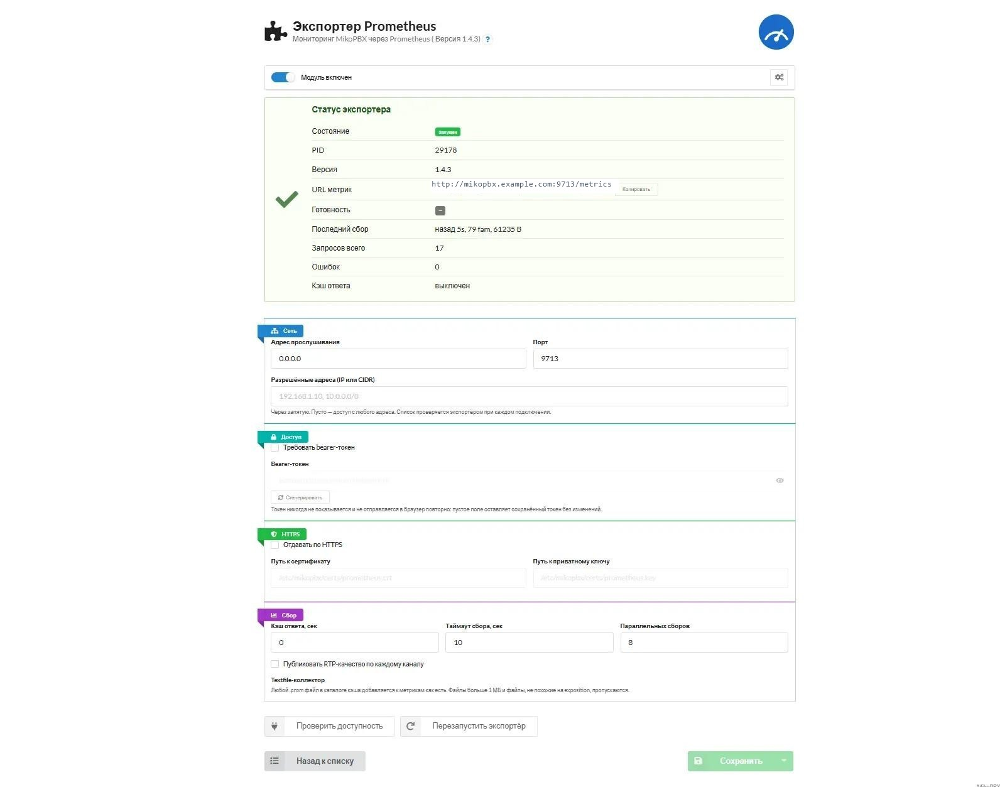

# ModulePrometheus

[English](README.md) | Русский

Модуль для MikoPBX, который отдаёт метрики в формате Prometheus
(text exposition format 0.0.4) по HTTP. Prometheus-сервер сам опрашивает
(scrапит) этот эндпоинт — push-агент, как в Zabbix, не нужен.



Версия `1.4.3` · GPL-3.0-or-later · PHP 8.4 · MikoPBX 2025.1.1+

[](https://github.com/kutyassistent-ops/MikoPBX_Prometheus/actions/workflows/ci.yml)

## Что отдаёт

`GET http://<mikopbx>:9713/metrics`

| Группа | Метрики |
|---|---|
| Экспортер | `mikopbx_exporter_build_info`, `up`, `start_time_seconds`, `scrapes_total`, `scrape_failures_total`, `scrape_timeouts_total`, `requests_total`, `auth_failures_total`, `active_children`, `http_responses_total{code}`, `request_duration_seconds_{sum,average}`, `config_info`, `collector_success{collector}`, `collector_duration_seconds`, `scrape_duration_seconds`, `scrape_families`, `scrape_timeout_seconds`, `memory_bytes`, `open_fds`, `gc_runs_total`, `block_present{block}`, `block_absent_reason{block,reason}`, `block_error_info` |
| Система | `mikopbx_system_uptime_seconds`, `load1/5/15`, `memory_*`, `swap_*`, `user_hz`, `cpu_seconds_total{cpu,mode}`, `cpu_jiffies_total{cpu,mode}` (устарело), `filesystem_{size,free,available,used}_bytes{mountpoint,device,fstype}`, `filesystem_inodes_*`, `network_receive/transmit_bytes_total`, `network_errors_total`, `processes`, `threads`, `file_descriptors_*` |
| Asterisk | `mikopbx_asterisk_up`, `info{version}`, `uptime_seconds`, `last_reload_seconds`, `channels_active`, `channels_by_type`, `calls_active`, `calls_processed_total`, `queue_callers`, `queue_active`, `queue_longest_wait_seconds`, `conferences_active`, `conference_participants`, `channel_quality_max{metric}`, `channel_quality_average{metric}`, `channel_quality{channel,metric}` (по настройке) |
| Вызовы (API) | `mikopbx_calls_active`, `calls_active_by_direction{direction}` |
| SIP | `mikopbx_sip_peers_total`, `_online`, `_online_ratio`, `_by_state` |
| Транки | `mikopbx_trunk_up{trunk,name}`, `trunk_state_info`, `sip_trunks{state}`, `trunk_channel_utilization_ratio`, `trunk_registered`, `trunk_state_transitions_total` |
| Статистика звонков | `mikopbx_trunk_calls`, `_calls_answered`, `_calls_duration_seconds`, `_calls_billsec_seconds`, `_answer_rate_ratio`, `_average_billsec_seconds`, `_average_ring_seconds`, `_average_hold_seconds`, `_calls_by_disposition`, `_short_calls`, `_long_calls`, `mikopbx_extension_missed_calls`, `mikopbx_stats_cache_age_seconds`, `mikopbx_stats_cache_missed_error_age_seconds` |
| Платформа | `mikopbx_database_size_bytes`, `mysql_status`, `webserver_status`, `time_sync_*`, `kernel_oom_kills_total`, `kernel_panics_total`, `modules_total`, `modules_enabled` |

Дополнительно: `/health`, `/-/healthy`, `/-/ready` (503, если падает сборщик),
`/-/info` (JSON-счётчики экспортёра), поддержка `HEAD` и gzip.

> [!warning] Авторизация выключена по умолчанию
> Свежая установка отдаёт метрики **без** заголовка `Authorization`, а
> экспортёр слушает `0.0.0.0`. Включите токен, ограничьте список
> разрешённых адресов или закройте порт правилом firewall модуля.
> Пока метрики открыты, страница настроек показывает предупреждение.

## Требования

- MikoPBX 2025.1.1+
- PHP 8.4
- Prometheus 2.x+ (сервер мониторинга)

## Установка

1. Возьмите готовый архив `dist/ModulePrometheus-1.4.3.zip` из этого
   репозитория (или соберите из исходников — см. ниже).
2. В веб-интерфейсе MikoPBX: **Модули** → **Установленные** → **Загрузить модуль**.
3. Включите модуль. Экспортёр запустится автоматически.

### Сборка из исходников

```powershell
# собирает dist/ModulePrometheus-<версия>.zip и проверяет раскладку
.\build-module.ps1
```

Скрипт не соберёт архив, если `module.json` лежит не в корне, и упадёт,
если в `bin/*.sh` попались CRLF-переводы строк.

## Настройка

На странице модуля задаются: адрес прослушивания (`0.0.0.0`), порт
(`9713`), список разрешённых адресов (IP или CIDR, пусто — любые), кэш
ответа в секундах (`0` — без кэша), таймаут сбора (`10`), максимум
параллельных сборов (`8`), требование bearer-токена (по умолчанию
**выключено**), HTTPS с путями к сертификату и ключу.

Bearer-токен в браузер не попадает: поле всегда пустое, пустое поле не
затирает сохранённый токен, сгенерировать новый можно одной кнопкой.
На странице есть кнопка «Перезапустить экспортёр» и живые счётчики
процесса экспортёра.

Также ограничьте доступ к порту на уровне firewall MikoPBX: разрешите
подключения только с адреса Prometheus-сервера.

### Пример prometheus.yml

```yaml
scrape_configs:
  - job_name: mikopbx
    scrape_interval: 60s
    scrape_timeout: 10s
    static_configs:
      - targets: ['192.168.1.10:9713']
    # если в модуле включён токен:
    # bearer_token_file: '/etc/prometheus/secrets/mikopbx.token'
```

> [!danger] Формула CPU легко считается неверно
> `mikopbx_system_cpu_seconds_total{cpu="all"}` — это **сумма** ядер, а
> не среднее. С 1.4.0 значения приходят в настоящих секундах, поэтому
> делить ни на что не надо:
>
> ```promql
> sum(rate(mikopbx_system_cpu_seconds_total{mode!="idle", cpu!="all"}[5m]))
>   / count(count by (cpu) (mikopbx_system_cpu_seconds_total{cpu!="all"}))
> ```
>
> Дашборды, собранные по формуле 1.3.x, надо поправить — убрать `/ 100`.
> Старые сырые значения по-прежнему доступны как
> `mikopbx_system_cpu_jiffies_total`.

### Правила алертинга

Готовый набор из 15 правил и 7 recording rules — в `examples/alerts.yml`.

## Архитектура

- `Lib/WorkerPrometheusExporter.php` — долгоживущий воркер; слушает порт
  (`stream_socket_server`, опционально TLS), форкает соединение, кэширует
  ответ, проверяет токен на каждый запрос.
- `Lib/Collectors/*` — сборщики: `System` (/proc), `Asterisk` (CLI),
  `Telemetry` (REST API v3), `CallStats` (файлы кэша), `Infrastructure`
  (платформа). `MetricsWriter` рендерит формат 0.0.4, `CollectorRegistry`
  оркестрирует и замеряет.
- `Lib/StatsCache.php` — cron-коллектор CDR-статистики, пишет кэш атомарно.
- `bin/prometheus-safe-script.sh` — проверка живости раз в минуту,
  `bin/prometheus-stats-cache.sh` — обновление кэша раз в 5 минут.
- `Lib/RestAPI/Status/` — REST API v3 для UI (статус, проверка доступности).

## Ограничения текущей версии

- Метрики «топ-10 процессов» из Zabbix-модуля не перенесены: в Prometheus
  для этого принято использовать per-process экспортеры.
- Метрики очередей, конференций и качества RTP зависят от версии Asterisk.
  При несовпадении формата вывода парсер молча отдаёт пустоту — смотрите
  `mikopbx_exporter_block_present` и `mikopbx_exporter_block_absent_reason`,
  а не только `collector_success`.
- Grafana-дашборд в поставку не входит; готовые правила алертинга — да.

## Структура репозитория

```
ModulePrometheus/
├── App/                          точка входа модуля, контроллер, форма, вольт настроек
├── Lib/
│   ├── WorkerPrometheusExporter.php   долгоживущий воркер: сокет, форк, кэш, токен
│   ├── Collectors/                   System, Asterisk, Telemetry, CallStats, Infrastructure
│   ├── MetricsCollector.php          интерфейс сборщика
│   ├── PrometheusConf.php            настройки
│   ├── PrometheusMain.php            логика модуля
│   ├── StatsCache.php                cron-кэш CDR
│   └── RestAPI/Status/               REST API v3 для интерфейса
├── Messages/                      переводы ru / en
├── Models/                        модель настроек
├── Setup/                         установка и обновление
├── public/assets/                 css, js, логотип
├── bin/                           экспортёр, проверка живости, обновление кэша
├── agi-bin/, db/                  каталоги-заглушки, нужны установщику
├── docs/                          документация (RU), скриншот
├── examples/alerts.yml            15 правил алертинга и 7 recording rules
├── dist/                          готовый архив для установки
├── build-module.ps1               сборщик архива
├── CHANGELOG.md                   история версий
├── LICENSE                        GPL-3.0
└── module.json                    манифест модуля
```

## Документация

- [`docs/Обзор модуля.md`](docs/Обзор%20модуля.md) — что делает модуль
- [`docs/Установка.md`](docs/Установка.md) — установка
- [`docs/Настройка модуля.md`](docs/Настройка%20модуля.md) — настройки
- [`docs/Подключение Prometheus.md`](docs/Подключение%20Prometheus.md) — сторона сервера
- [`docs/Алертинг и Grafana.md`](docs/Алертинг%20и%20Grafana.md) — правила алертинга и дашборды
- [`docs/Справочник метрик.md`](docs/Справочник%20метрик.md) — справочник метрик
- [`docs/Архитектура.md`](docs/Архитектура.md) — устройство модуля
- [`docs/Разработка и отладка.md`](docs/Разработка%20и%20отладка.md) — разработка
- [`docs/Траблшутинг.md`](docs/Траблшутинг.md) — разбор проблем

## Разработка

- Все скрипты `bin/*.sh` должны иметь LF-переводы строк.
- Права на запуск (`chmod 755`) модуль выставляет сам при запуске службы.
- Вольт-шаблоны читают переменные представления как обычные PHP-переменные:
  передавайте скаляры, а не массивы — `{{ x.y }}` до элемента массива не доходит.
- Стиль кода — как в модулях MikoPBX (PHP 8.4, Phalcon 5).

## Известные особенности

> [!warning] Метрики по умолчанию открыты всем
> Свежая установка отдаёт метрики **без** заголовка `Authorization`, а
> экспортёр слушает `0.0.0.0`. Включите токен, ограничьте список
> разрешённых адресов или закройте порт правилом firewall модуля.
> Пока метрики открыты, страница настроек показывает предупреждение.

> [!warning] `cpu="all"` — это сумма ядер, а не среднее
> Формула CPU легко считается неверно: без фильтра `cpu!="all"` загрузка
> показывается вдвое выше. С 1.4.0 значения приходят в настоящих секундах,
> поэтому делить ни на что не надо. Старый сырой счётчик доступен как
> `mikopbx_system_cpu_jiffies_total`.

> [!info] Отсутствие метрик не равно поломке экспортёра
> Если формат вывода Asterisk не совпал с ожидаемым, парсер вернёт пустоту.
> Смотрите `mikopbx_exporter_block_present` и
> `mikopbx_exporter_block_absent_reason`, а не только `collector_success`.

> [!info] Панели транков читают кэш, а не живые данные
> Кэш наполняет cron раз в 5 минут. Пустые bargauge чаще всего означают
> незаполненный кэш, а не отсутствие звонков. Показатель «Возраст кэша
> статистики» покажет, что именно случилось.

> [!note] Значения CPU стали настоящими секундами с 1.4.0
> Дашборды, собранные по формуле 1.3.x, надо поправить — убрать `/ 100`.

> [!info] Готового дашборда Grafana в поставке нет
> Готовые правила алертинга — да: 15 правил и 7 recording rules в
> `examples/alerts.yml`.

> [!warning] `module.json` должен лежать в корне архива
> Если модуль упакован в папку `ModulePrometheus/`, установка в MikoPBX
> падает с «module.json not found in the module archive».

## Проверка в CI

На каждом пуше:

- собирается zip модуля (`build-module.ps1`) и проверяется раскладка
  архива: `module.json` в корне, записей с обратными слэшами нет;
- `php -l` по всем PHP-файлам;
- собранный архив отдаётся как артефакт прогона.

## Лицензия

GPL-3.0-or-later — полный текст в [LICENSE](LICENSE).

## Связанные проекты

| Проект | Роль |
|---|---|
| [`grafana-dashboards`](https://github.com/kutyassistent-ops/grafana-dashboards) | Дашборды, построенные на этих метриках (MikoPBX, принтеры, CCTV) |
| [`grafana-bitrix-relay`](https://github.com/kutyassistent-ops/grafana-bitrix-relay) | Доставка алертов из Grafana в чат Битрикс24 |
| [`MikoPBX_birix_notify`](https://github.com/kutyassistent-ops/MikoPBX_birix_notify) | Модуль MikoPBX: уведомления о звонках в Битрикс24 |
