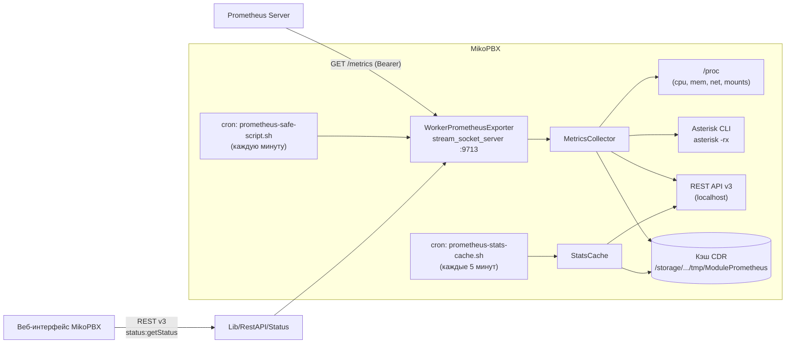
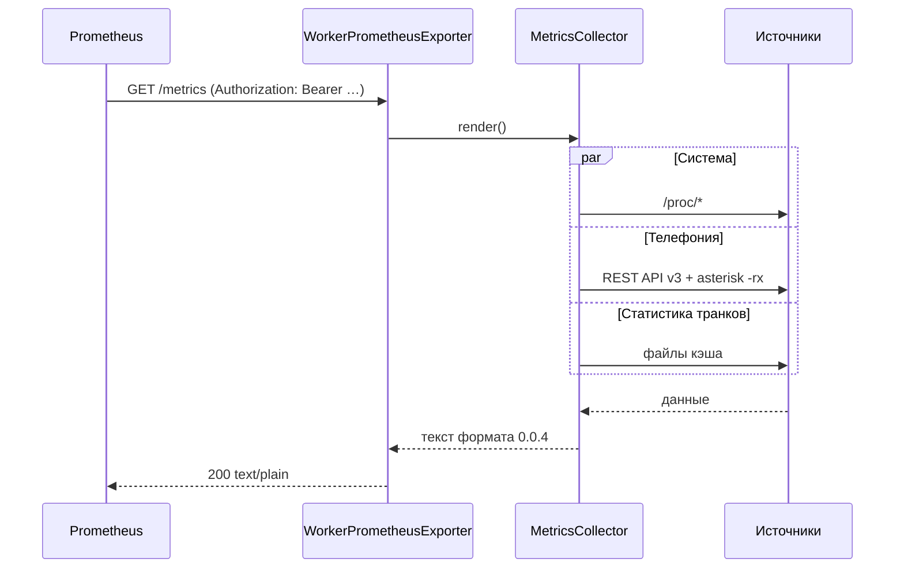

---
tags:
  - mikopbx
  - prometheus
  - architecture
aliases:
  - Архитектура модуля
created: 2026-10-16
updated: 2026-10-19
---

# Архитектура

## Диаграмма компонентов

## Поток одного скрейпа

## Компоненты кода

| Файл | Роль |
|---|---|
| `Lib/WorkerPrometheusExporter.php` | Долгоживущий воркер: `stream_socket_server` (TCP или TLS), форк на соединение, отчёт ребёнка в родителя через `socketpair`, лимит одновременных сборов, фильтр адресов источника, маршруты `/metrics`, `/health`, `/-/healthy`, `/-/ready`, `/-/info`, `HEAD`, gzip, проверка Bearer-токена на каждый запрос, graceful-остановка по SIGTERM |
| `Lib/MetricsCollector.php` | Тонкая фасадка: собирает реестр коллекторов, передаёт дедлайн сбора и склеивает textfile-сниппеты. Вся логика вынесена в `Lib/Collectors/` |
| `Lib/Collectors/MetricsWriter.php` | Рендер exposition-формата 0.0.4: `HELP`/`TYPE`, экранирование, пропуск пустых семейств, счётчик семейств |
| `Lib/Collectors/AbstractCollector.php` | Обвязка `try/catch (Throwable)`, таймер, `lastError` |
| `Lib/Collectors/SystemCollector.php` | `/proc`: uptime, load, память, CPU (секунды + jiffies), ФС с инодами, сеть, процессы, потоки, дескрипторы |
| `Lib/Collectors/AsteriskCollector.php` | Asterisk CLI: версия, uptime, каналы, очереди, конференции, качество RTP (агрегаты и, по настройке, по каналам) |
| `Lib/Collectors/TelemetryCollector.php` | REST API v3: активные вызовы, SIP-пиры, транки |
| `Lib/Collectors/CallStatsCollector.php` | Файлы кэша CDR: окна, ASR/ACD, disposition, пропущенные, свежесть кэша |
| `Lib/Collectors/InfrastructureCollector.php` | Платформа: размеры БД, MySQL, nginx, NTP, ядро, модули, рантайм PHP и метрики самого экспортёра |
| `Lib/Collectors/CollectorRegistry.php` | Оркестрация, дедлайн сбора, `collector_success`, `collector_duration_seconds`, валидация textfile-сниппетов |
| `Lib/StatsCache.php` | Cron-коллектор CDR-статистики; атомарная запись (`.tmp` + `rename`); при сбое источника прежние значения пропущенных сохраняются |
| `Lib/ApiHelper.php` | Обёртка над `PBXCoreRESTClientProvider`, пути к каталогам кэша |
| `Lib/PrometheusMain.php` | Жизненный цикл: настройки (с кэшем инстанса), `start/stop/restart`, TLS, нормализация адреса, сборка endpoint (IPv6 в скобках), фильтр адресов источника |
| `Lib/PrometheusConf.php` | Хуки MikoPBX: enable/disable, рестарт при изменении настроек, проверка порта, firewall (с источником, если задан список), cron |
| `Lib/RestAPI/Status/*` | REST API v3 для UI: `status:getStatus`, `status:testConnection`, `status:getExporterInfo` |
| `bin/prometheus-exporter` | Обёртка запуска: `exec php -f …/WorkerPrometheusExporter.php "$@"` |
| `bin/prometheus-safe-script.sh` | Health-check раз в минуту; уважает маркер `bin/disabled` |
| `bin/prometheus-stats-cache.sh` | Обёртка cron-коллектора с `flock` |

## Жизненный цикл

| Событие | Действие |
|---|---|
| Включение модуля | `onBeforeModuleEnable` проверяет, что порт свободен → `onAfterModuleEnable` снимает маркер `disabled` и запускает воркер |
| Старт PBX | `onAfterPbxStarted` → `startService()` |
| Сохранение настроек | `modelsEventChangeData` → `restartService()` (инстанс сбрасывается, чтобы поднять воркер с новым портом) |
| Отключение модуля | `onAfterModuleDisable` → `stopService()` + маркер `disabled` |
| Удаление модуля | `unInstallFiles()` → остановка воркера и снос каталога кэша |
| Воркер упал | cron health-check поднимает в течение минуты |

## Принятые решения

> [!note] Почему свой воркер, а не node_exporter
> Модуль самодостаточен: не требуется тянуть статические бинарники,
> собирать их в CI и поддерживать архитектуры amd64/arm64. Системные
> метрики читаются из `/proc` прямо в PHP.

> [!note] Почему статистика транков — из кэша
> `cdr:getStatsByProvider` вызывается по каждому транку за два периода.
> При скрейпе раз в минуту это лавина запросов (та же проблема, что
> решал Zabbix-модуль). Поэтому тяжёлые данные обновляет cron раз
> в 5 минут, а скрейп читает плоские файлы — операция `read()`.

> [!note] Почему плоские файлы, а не БД
> Минимум зависимостей и атомарность: `rename()` в пределах одной ФС
> гарантирует, что читатель никогда не увидит полузапись.

## Безопасность

- REST-эндпоинты модуля защищены штатной схемой MikoPBX
  (LOCALHOST + BEARER_TOKEN) — как у Zabbix-модуля.
- Экспортёр: доступ ограничивается списком разрешённых адресов
  (проверяется на каждом подключении), firewall-правилом и опциональным
  Bearer-токеном. Токен в браузер не попадает.
- Bearer-токен сравнивается через `hash_equals`.
- Кэш-файлы лежат в `/storage/.../tmp` — вне веб-корня.
- Ввод извне отсутствует: все параметры — из БД MikoPBX.

## Устойчивость

| Механизм | Что защищает |
|---|---|
| Форк на соединение | Медленный или враждебный клиент не занимает accept-цикл |
| `socketpair` для отчёта ребёнка | Счётчики агрегируются в родителе, ребёнок их не трогает |
| Лимит одновременных сборов | Всплеск скрейпов не плодит форки; сверх лимита — `503` |
| Фильтр адресов источника | Посторонний клиент отсекается на входе (`403`) |
| Дедлайн сбора | Сбор, не уложившийся в `scrape_timeout`, прерывается, скрейп считается неуспешным |
| Валидация textfile-сниппетов | Сломанный `.prom` не портит весь ответ |
| Сохранение последних данных пропущенных | Временный сбой источника не выглядит как «никто не пропустил» |

## Дальше

- [[Разработка и отладка]] — как поднять и отладить вручную
- [[Справочник метрик]] — что отдаёт каждая группа
